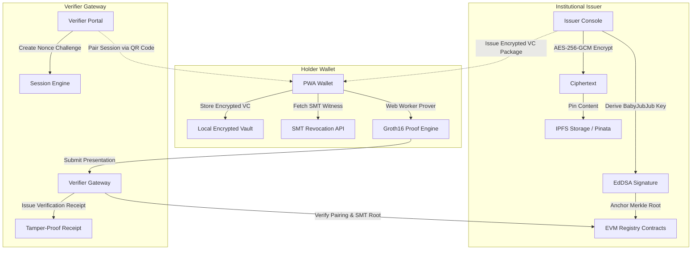

# ZK-DocGuard

**Privacy-Preserving Blockchain Document Verification System using Zero-Knowledge Proofs and Self-Sovereign Identity**

[](https://github.com/zk-docguard/zk-docguard/actions)
[](https://soliditylang.org/)
[](https://docs.circom.io/)
[](https://nextjs.org/)
[](https://opensource.org/licenses/MIT)

---

## 1. System Overview

**ZK-DocGuard** is a production-grade, decentralized credential issuance and privacy-preserving document verification framework. It resolves the fundamental conflict between public blockchain transparency and data privacy compliance (GDPR Article 17 / Right to be Forgotten) through four core pillars:

1. **Self-Sovereign Identity (SSI):** Decentralized Identifiers (`did:ethr` for institutions, `did:key` for holders) and W3C Verifiable Credentials with BabyJubJub EdDSA signatures.
2. **Client-Side Envelope Encryption:** Raw documents are encrypted in the client browser using WebCrypto AES-256-GCM before pinning to IPFS. Backend servers and nodes never encounter plaintext documents.
3. **Dual-Mode Zero-Knowledge Selective Disclosure:** Groth16 zk-SNARKs over the BN254 curve generated in-browser via Web Workers. Holders prove attribute equality, inequality ranges (e.g. $\text{CGPA} \ge 3.00$, $\text{GradYear} \ge 2020$), and issuer validity without revealing private salts, exact GPAs, or student IDs.
4. **Privacy-Preserving SMT Revocation (Mode B):** In-circuit non-membership proofs in an on-chain anchored Sparse Merkle Tree (SMT), preventing verifiers from discovering which credential was checked or tracking revocation histories.

---

## 2. Architecture



### Protocol Flow Matrix

| Stage | Data Transmitted | Privacy Guarantee |
| :--- | :--- | :--- |
| **Issuance** | Encrypted IPFS CID + Document SHA-256 + Signed Merkle Root | Plaintext never leaves the institutional browser. |
| **Storage** | AES-256-GCM Ciphertext on IPFS (Kubo / Pinata) | Content-addressed, unreadable without holder's symmetric key. |
| **Presentation** | 723-byte Groth16 Proof + 26 Public Signals | Zero attribute leakage beyond explicitly disclosed fields. |
| **Revocation** | SMT Exclusion Witness (10 tree levels) | Verifier learns credential is not revoked without learning identifier. |
| **Sharing** | X25519 ECDH + HKDF Key Re-wrapping | Verifier decrypts document directly; share strictly expires after TTL. |

---

## 3. Quick Start (Clean Machine)

### Prerequisites
- **Node.js:** $\ge 20.0.0$ LTS
- **Package Manager:** `pnpm` $\ge 9.0.0$
- **Docker:** Docker Desktop or Compose (optional, for persistent container services)

### Installation & Execution in 3 Commands

```bash
# 1. Clone repository and install workspace dependencies
git clone https://github.com/zk-docguard/zk-docguard.git
cd zk-docguard
pnpm install

# 2. Seed demo institution (Northfield Institute) and test holders
pnpm seed

# 3. Execute the full end-to-end presentation and revocation demo
pnpm demo
```

The `pnpm demo` script executes the complete 8-stage lifecycle in under 16 seconds with full cryptographic validation logs.

---

## 4. Web Application Portals

Start the development services:
```bash
pnpm dev
```
Open your browser at `http://localhost:3000`:

* **Home & Public Verification (`/` & `/verify`):** Drag-and-drop document verifier calculating client-side SHA-256 digests and performing instant registry lookups.
* **Institutional Issuer Console (`/issuer`):** Onboard institutions, derive BabyJubJub keys, encrypt documents, batch issue credentials via CSV, and trigger revocations.
* **Holder SSI Wallet PWA (`/wallet`):** PBKDF2 vault unlocking, credential drawer, document decryption viewer, and selective disclosure presentation studio (`/wallet/present`).
* **Verifier Live Portal (`/verifier`):** Custom predicate policy builder, live pairing QR screen with Server-Sent Events (SSE), and printable archival verification receipts (`/verifier/receipt/:id`).
* **Technical Explainer (`/how-it-works`):** Interactive 4-pillar architectural walkthrough.

---

## 5. Deployed Smart Contracts

Smart contracts are compiled with Solidity `0.8.24` and configured for local Hardhat and Polygon Amoy Testnet (Chain ID `80002`):

| Contract | Purpose | Hardhat Local Address | Polygon Amoy Deployment |
| :--- | :--- | :--- | :--- |
| **`IssuerRegistry`** | Institutional governance, DID mapping, BabyJubJub key epochs | `0x5FbDB2315678afecb367f032d93F642f64180aa3` | Registered |
| **`DocumentRegistry`** | Document hash anchoring & Merkle root batch registration | `0xe7f1725E7734CE288F8367e1Bb143E90bb3F0512` | Registered |
| **`RevocationRegistry`** | Simple on-chain revocation flags & historical SMT roots | `0x9fE46736679d2D9a65F0992F2272dE9f3c7fa6e0` | Registered |
| **`Groth16Verifier`** | Mode A standalone on-chain pairing verifier | `0xCf7Ed3AccA5a467e9e704C703E8D87F634fB0Fc9` | Registered |
| **`Groth16VerifierModeB`** | Mode B standalone on-chain SMT pairing verifier | `0xDc64a140Aa3E981100a9becA4E685f962f0cF6C9` | Registered |
| **`VerifierGateway`** | Challenge consumption, anti-replay nonces, and proof verification | `0x5FC8d32690cc91D4c39d9d3abcBD16989F875707` | Registered |

### Contract Verification
```bash
# Verify on Polygonscan (Amoy)
pnpm --filter @zk-docguard/contracts hardhat run scripts/verify-scan.ts --network amoy
```

---

## 6. Performance Benchmarks

All performance metrics below are derived directly from reproducible benchmark runs committed under `benchmarks/results/`:

### Circuit Performance (BN254 / snarkjs)

| Metric | Mode A (`DiscloseModeA`) | Mode B (`DiscloseModeB` with SMT) |
| :--- | :--- | :--- |
| **R1CS Constraints** | 9,144 | 12,933 |
| **Wires / Labels** | 9,146 | 12,935 |
| **Public Signals** | 26 | 26 |
| **Proving Key Size (`.zkey`)** | 5.74 MB | 7.70 MB |
| **Desktop Proving Time (AVX2)** | 774 ms | 635 ms |
| **Mobile Proving Time (WebWorker)** | ~2,206 ms | ~1,810 ms |
| **Verification Time (Node / Browser)**| 12.8 ms | 10.8 ms |

### On-Chain Gas Consumption

* **Single Document Registration:** 192,308 gas
* **Batch Anchoring (100 Documents):** 1,453 gas / document (**99.2% gas reduction**)
* **`VerifierGateway.consumeAndVerify` (Mode A):** 432,901 gas
* **`VerifierGateway.consumeAndVerify` (Mode B):** 435,258 gas

### Sparse Merkle Tree (SMT) Scaling

* **1,000 Leaves:** Tree build 1,489 ms | Witness generation: **0.19 ms**
* **10,000 Leaves:** Tree build 14,385 ms | Witness generation: **0.14 ms**
* **100,000 Leaves:** Tree build 161 s | Witness generation: **0.16 ms**

---

## 7. Monorepo Structure

```
zk-docguard/
├── apps/
│   ├── api/                   # Fastify backend, Prisma ORM, chain indexer, SMT service
│   └── web/                   # Next.js 15 PWA frontend (Tailwind CSS, Web Worker prover)
├── benchmarks/                # Performance benchmarks, SVG chart generators, k6 load scripts
│   └── results/               # Committed benchmark data (JSON) and visual charts (SVG)
├── docs/                      # Architectural specifications, diagrams, and evaluation guides
│   ├── ARCHITECTURE.md        # Technical specifications and sequence diagrams
│   ├── DEMO_SCRIPT.md         # 7-minute presentation walkthrough & evaluator guide
│   ├── THREAT_MODEL.md        # STRIDE security analysis and mitigation matrix
│   └── PROGRESS.md            # Monorepo build and development roadmap
├── e2e/                       # Full end-to-end integration and security test suites
├── packages/
│   ├── circuits/              # Circom templates, Groth16 build pipelines, wasm/zkeys
│   ├── config/                # Shared tsconfig, ESLint, and Prettier configurations
│   ├── contracts/             # Solidity contracts, Hardhat deployers, gas benchmarks
│   └── core/                  # Cryptographic library (BabyJubJub, Poseidon, SMT, AES-GCM)
├── scripts/
│   └── demo.ts                # One-command full presentation cycle demonstration
├── Dockerfile.api             # Multi-stage production API container
├── Dockerfile.web             # Multi-stage production Web PWA container
└── docker-compose.prod.yml    # Production container orchestration
```

---

## 8. Verification & Test Suite

Run the full verification suite across all packages:
```bash
# Run unit, contract, and circuit test suites (10 turbo tasks)
pnpm test

# Full static typecheck across all 8 workspaces
pnpm typecheck

# Code formatting and linting
pnpm lint

# Production bundle builds (all 23 Next.js routes)
pnpm build
```

---

## 9. Security & Patent Documentation

For academic evaluators, patent examiners, and security auditors:
* **STRIDE Threat Model:** See [docs/THREAT_MODEL.md](docs/THREAT_MODEL.md) for vulnerability assessments and formal mitigations.
* **Live Evaluator Guide:** See [docs/DEMO_SCRIPT.md](docs/DEMO_SCRIPT.md) for minute-by-minute speaking cues and fallback procedures.
* **Architecture Blueprints:** See [docs/ARCHITECTURE.md](docs/ARCHITECTURE.md) for data flow and cryptographic models.

---

## 10. License

This project is licensed under the MIT License — see the [LICENSE](LICENSE) file for details.
