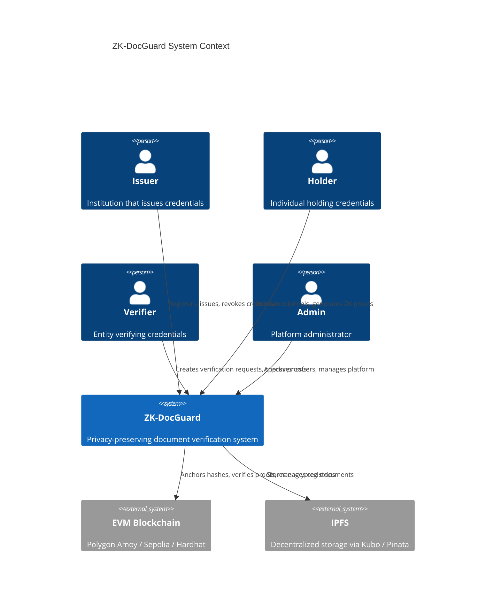
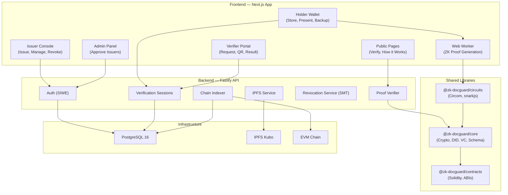
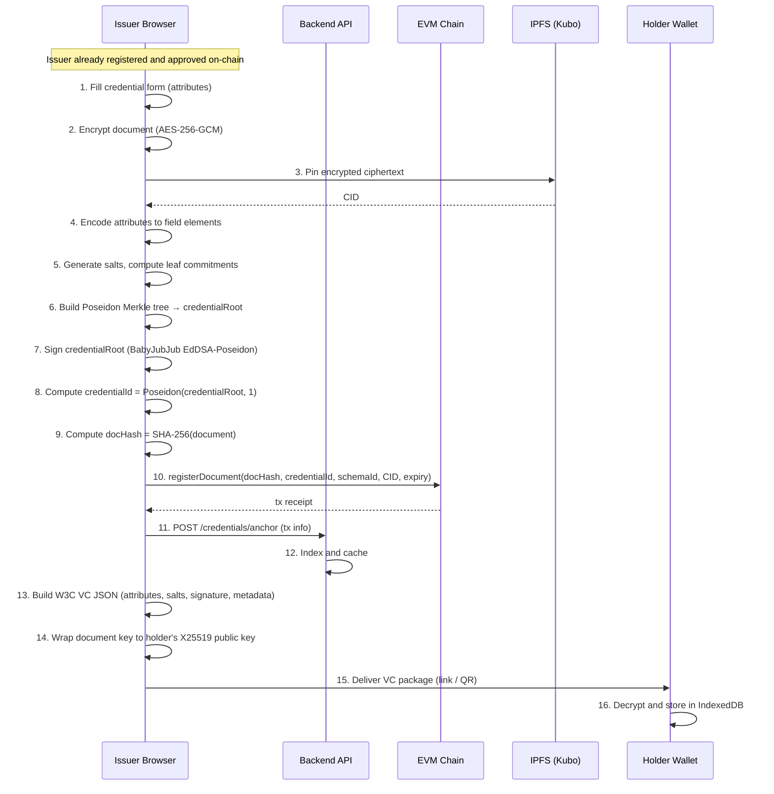
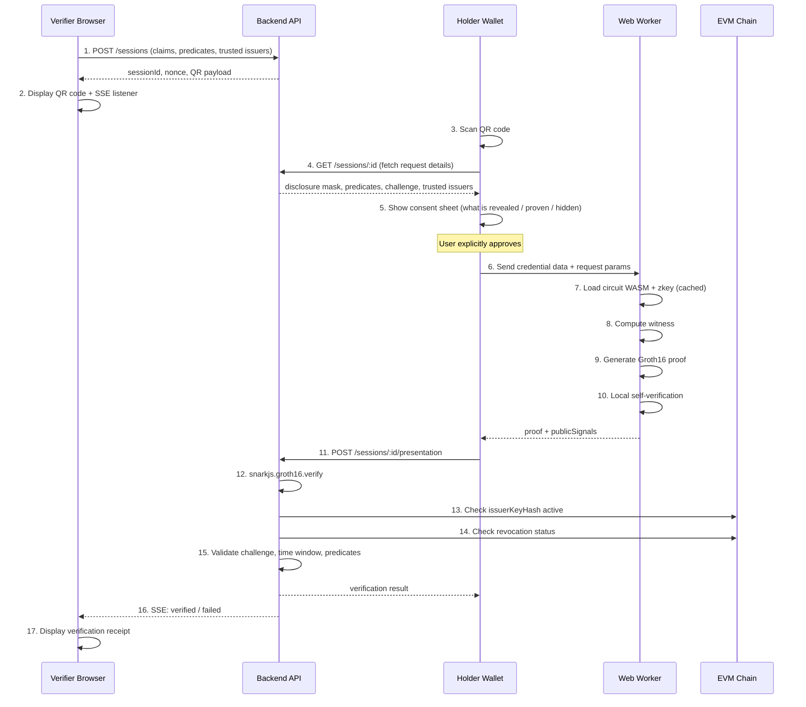
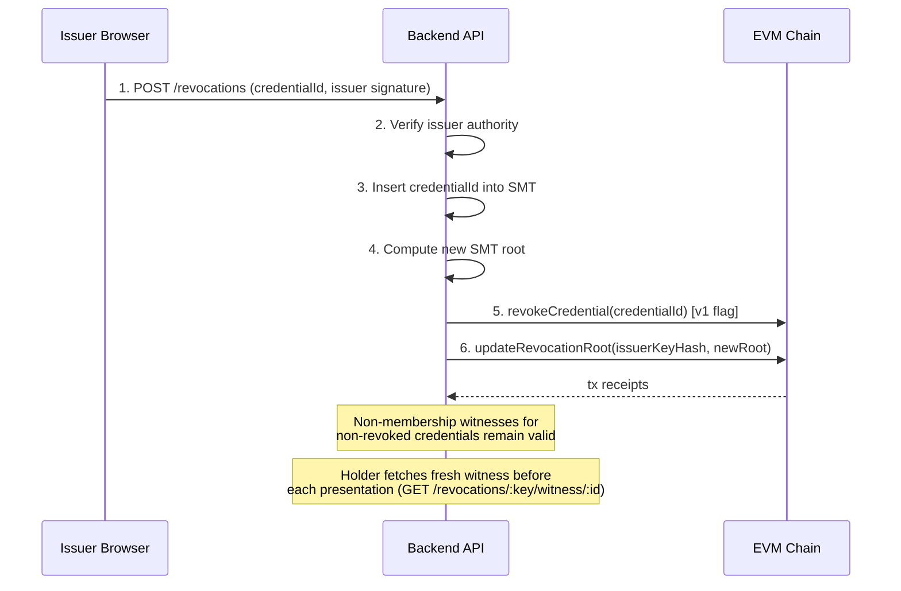
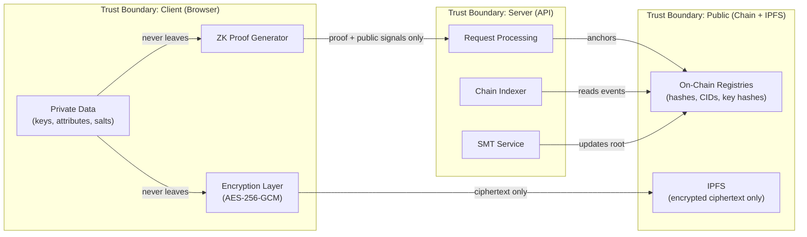

# ZK-DocGuard — System Architecture

> Privacy-Preserving Blockchain Document Verification System using Zero-Knowledge Proofs and Self-Sovereign Identity

---

## 1. Context Diagram

---

## 2. Component Diagram

---

## 3. Credential Issuance Sequence

---

## 4. Selective Disclosure Presentation Sequence

---

## 5. Revocation Sequence (Mode B — SMT)

---

## 6. Data Flow and Trust Boundaries

---

## 7. Technology Stack Summary

| Layer                 | Technology                                      | Version                  |
| --------------------- | ----------------------------------------------- | ------------------------ |
| Monorepo              | pnpm + Turborepo                                | pnpm 9, Turbo 2.x        |
| Contracts             | Solidity, Hardhat, OpenZeppelin v5              | 0.8.24                   |
| Chains                | Hardhat local, Polygon Amoy, Sepolia            | —                        |
| ZK Proofs             | Circom, snarkjs (Groth16, BN254)                | Circom 2.1.x             |
| Hashing (circuit)     | Poseidon                                        | circomlib                |
| Signatures (circuit)  | BabyJubJub EdDSA-Poseidon                       | circomlib                |
| Hashing (off-circuit) | SHA-256, keccak256                              | WebCrypto, Solidity      |
| Encryption            | AES-256-GCM, X25519 ECDH + HKDF                 | WebCrypto, @noble/curves |
| Identity              | did:ethr, did:key (Ed25519)                     | ethr-did-resolver        |
| Backend               | Fastify, Prisma, PostgreSQL 16                  | Fastify 5, PG 16         |
| Frontend              | Next.js (App Router), React 19, Tailwind CSS    | Next 15                  |
| Storage               | IPFS (Kubo), Pinata (optional)                  | Kubo 0.32.x              |
| Testing               | Hardhat/chai, vitest, circom_tester, Playwright | —                        |
| CI                    | GitHub Actions                                  | —                        |
