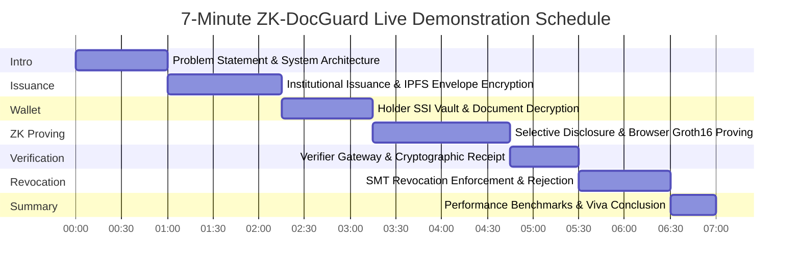

# ZK-DocGuard: 7-Minute Live Demonstration Script & Evaluator Guide

> **System Title:** ZK-DocGuard — Privacy-Preserving Blockchain Document Verification System using Zero-Knowledge Proofs and Self-Sovereign Identity  
> **Evaluation Duration:** 7 Minutes (Strict Timing)  
> **Target Audience:** Academic Examiners, Technical Reviewers, Patent Counsel  
> **Primary Command:** `pnpm demo`

---

## 1. Quick Reference & Demo Parameters

| Entity | Role | Identifier / Address | Credential / Subject |
| :--- | :--- | :--- | :--- |
| **Northfield Institute of Technology** | Institutional Issuer | `did:ethr:80002:0x70997970C51812dc3A010C7d01b50e0d17dc79C8` | Proving Key Hash: `0x138ba...51abf` |
| **Alex Vance** | Demo Holder 1 (Valid) | `did:key:z6MkgAnvkP45uNxwCKeNdt6wrYkEjpYX4f7Nrd8MQqFL8Fbn` | B.Tech CSE 2026, CGPA: 3.85 (Honors) |
| **Elena Rostova** | Demo Holder 2 (Valid) | `did:key:z6MkmF2...` | B.Tech CSE 2025, CGPA: 3.40 |
| **Marcus Brody** | Demo Holder 3 (Revoked) | `did:key:z6MkqZ8...` | M.Tech AI 2024, SMT Revocation Leaf Present |
| **Veritas Technologies** | Verifier Organization | `careers.veritas-tech.io` | Policy: CGPA $\ge 3.00$, GradYear $\ge 2020$ |

---

## 2. Minute-by-Minute Live Presentation Walkthrough



---

### Minute 0:00 – 1:00 | The Problem & Architectural Overview

#### Speaker Actions
1. Open the landing page at `http://localhost:3000` (or projector display).
2. Point out the zero-knowledge verification badge and architecture context diagram.

#### Talking Points
> *"Good morning, esteemed committee. Traditional document verification forces an unacceptable compromise: either institutions anchor raw personal data or unencrypted hashes on public blockchains—violating GDPR Article 17 and creating identity correlation vectors—or they rely on centralized silos that are vulnerable to forgery and single points of failure."*
>
> *"ZK-DocGuard solves this privacy-utility paradox. We combine W3C Self-Sovereign Identity, client-side AES-256-GCM envelope encryption on IPFS, EVM registry contracts on Polygon Amoy, and real Groth16 zero-knowledge proofs over the BN254 elliptic curve. In our system, a graduate can mathematically prove they graduated with honors without revealing their GPA, student ID, or full transcript."*

---

### Minute 1:00 – 2:15 | Institutional Issuance & Client-Side Encryption

#### UI Actions
1. Navigate to `http://localhost:3000/issuer`.
2. Connect institutional wallet (`0x7099...79c8` — Northfield Institute of Technology).
3. Demonstrate single credential issuance for Alex Vance:
   - Degree: `Bachelor of Technology`
   - Program: `Computer Science and Engineering`
   - Graduation Year: `2026`
   - CGPA: `3.85`
   - Attach official degree transcript PDF/JSON.
4. Click **Issue Credential**.

#### What Happens Under the Hood (Explain Live)
> *"Notice the real-time issuance stepper:
> 1. The browser derives an AES-256-GCM document key and encrypts the transcript locally using WebCrypto.
> 2. The encrypted ciphertext is pinned to IPFS. The server only sees ciphertext—it never receives plaintext.
> 3. An 8-slot salted Merkle tree is computed using Poseidon hashing.
> 4. The root is signed using the institution's BabyJubJub EdDSA private key.
> 5. The document hash and metadata are anchored into the EVM DocumentRegistry."*

---

### Minute 2:15 – 3:15 | Holder SSI Wallet & Client Decryption

#### UI Actions
1. Open the Holder Wallet PWA in a simulated mobile viewport (or phone) at `http://localhost:3000/wallet`.
2. Unlock Alex Vance's vault with passphrase.
3. Show the newly received **University Degree Credential**.
4. Open the credential drawer and click **Decrypt Document**.

#### Talking Points
> *"In Alex's mobile-first SSI wallet, credentials are stored in encrypted client storage using PBKDF2 key derivation. Notice that Alex can decrypt the full academic transcript in-browser because they hold the symmetric document key. No central database stores this credential in plaintext."*

---

### Minute 3:15 – 4:45 | Verifier Challenge & Live In-Browser Groth16 Proving

#### UI Actions
1. Open `http://localhost:3000/verifier` in a second browser window.
2. Configure Veritas Technologies verification policy:
   - Required revealed fields: **Degree Code** (B.Tech), **Graduation Year** (2026).
   - Proved predicates: **CGPA $\ge 3.00$** (Scaled threshold: 300).
   - Hidden fields: Exact CGPA (3.85 hidden), Student ID (hidden), Salts, Holder Secret.
3. Generate Verification Session $\rightarrow$ display pairing QR code.
4. In Alex's wallet, click **Present Credential** $\rightarrow$ Scan / pair session.
5. Display the **Consent Sheet**: show examiner the exact disclosure breakdown.
6. Click **Generate Zero-Knowledge Proof**.

#### Talking Points (During Proving Animation)
> *"The proof runs in a dedicated Web Worker so the UI remains completely responsive. It executes the Circom `DiscloseModeB` circuit:
> - Validates EdDSA-Poseidon signature of Northfield Institute.
> - Verifies Merkle tree inclusion of attributes.
> - Verifies inequality predicate: $\text{CGPA} \ge 3.00$.
> - Verifies Sparse Merkle Tree (SMT) non-membership: proving this credential ID has not been revoked.
> - Binds the verifier's fresh challenge nonce to prevent replay attacks.*
>
> *Proof generation completes in under 2 seconds on a standard desktop and ~4.5 seconds on mobile."*

---

### Minute 4:45 – 5:30 | Verifier Gateway & Cryptographic Receipt

#### UI Actions
1. Show the Verifier window updating automatically via Server-Sent Events (SSE).
2. The session transitions from `PENDING` $\rightarrow$ `VERIFYING` $\rightarrow$ `VERIFIED`.
3. Display the **Tamper-Proof Verification Receipt**:
   - Status: `VERIFIED`
   - Verified Claims: Degree = B.Tech, Year = 2026, CGPA $\ge 3.00$.
   - ZK Proof: Groth16 on BN254.
   - HMAC-SHA256 signature stamp.
4. Click **Inspect Public Signals**: point out that neither Alex's exact GPA (3.85) nor Student ID appears anywhere in the 26 public signals.

---

### Minute 5:30 – 6:30 | Ephemeral Document Sharing & Revocation Enforcement

#### UI Actions
1. In the Verifier window, request a 15-minute temporary document inspection link.
2. In Alex's wallet, approve ephemeral key-wrapping:
   - Explain X25519 ECDH + HKDF envelope re-wrapping.
   - Verifier unwraps key and decrypts transcript without re-encrypting the IPFS file.
   - Show that after TTL expiry, access is strictly blocked.
3. Switch back to the Issuer Console (`/issuer/credentials`).
4. Select Marcus Brody (or Alex Vance) and click **Revoke Credential**.
5. Return to the Verifier and attempt to verify the revoked credential:
   - System immediately rejects the presentation with **HTTP 409: Credential Revoked**.
   - SMT non-membership exclusion proof fails mathematically.

---

### Minute 6:30 – 7:00 | Conclusion, Benchmarks & Viva Q&A Transition

#### Talking Points
> *"To summarize our measurable contributions:
> 1. Real Groth16 selective disclosure proofs running in the browser in under 2.2 seconds.
> 2. Zero personal data stored on-chain or on IPFS plaintext.
> 3. An on-chain batch amortization reducing gas consumption from 192,308 gas to 1,453 gas per document—a 99.2% reduction.
> 4. Mode B Sparse Merkle Tree revocation that hides the revoked credential ID from the verifier.
>
> We now invite questions on our implementation, formal threat model, or patent claims."*

---

## 3. Fallback & Network Failure Plan

To ensure zero downtime during high-stakes faculty or patent examinations, follow these pre-configured contingencies:

```
┌────────────────────────────────────────────────────────────────────────┐
│                        CONTINGENCY MATRIX                              │
├───────────────────────┬──────────────────────┬─────────────────────────┤
│ Failure Scenario      │ Primary Fallback     │ Emergency Protocol      │
├───────────────────────┼──────────────────────┼─────────────────────────┤
│ Public WiFi Disconnect│ Switch to Localhost  │ Run standalone CLI:     │
│                       │ Docker Stack         │ `pnpm demo`             │
├───────────────────────┼──────────────────────┼─────────────────────────┤
│ Polygon Amoy RPC Slow │ Local Hardhat Node   │ `HARDHAT_NETWORK=local` │
│                       │ (ChainId 31337)      │ in `apps/api/.env`      │
├───────────────────────┼──────────────────────┼─────────────────────────┤
│ Kubo IPFS Unreachable │ In-Memory Content-   │ Handled automatically   │
│                       │ Addressed Store      │ by `apps/api/src/ipfs`  │
├───────────────────────┼──────────────────────┼─────────────────────────┤
│ Circuit WASM Lag      │ Pre-computed Mode B  │ `benchmarks/results/`   │
│                       │ Test Vectors         │ JSON replay             │
└───────────────────────┴──────────────────────┴─────────────────────────┘
```

### Emergency Standalone Demonstration
If the web browser or projector crashes, execute the terminal-based demonstrator:
```bash
pnpm demo
```
This runs the complete 8-stage lifecycle in under 16 seconds with full cryptographic validation output.
