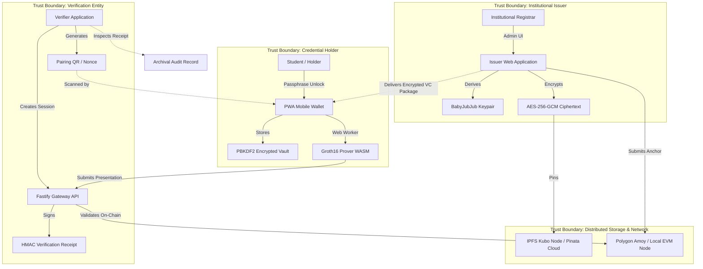
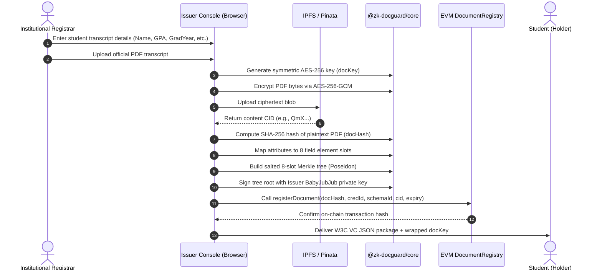
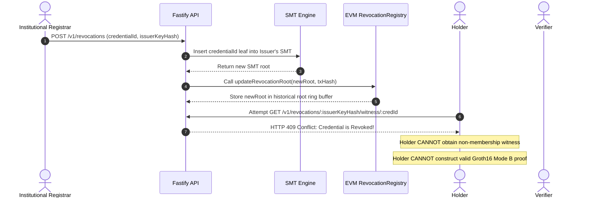
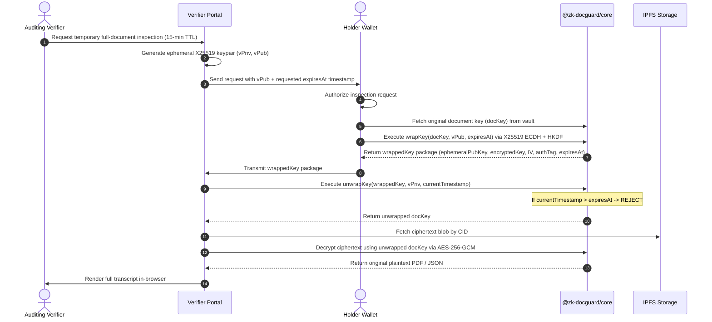

# Chapter 4: System Architecture and Design

---

## 4.1 System Context and Ecosystem Actors

ZK-DocGuard establishes an open, decentralized ecosystem comprising four primary operational entities operating across distinct trust boundaries:



### Ecosystem Entities and Responsibilities

1. **Institutional Issuer (e.g., University Registrar):**
   - Holds an Ethereum account representing an institutional Decentralized Identifier (`did:ethr`).
   - Maintains an approved status within the on-chain `IssuerRegistry` contract.
   - Derives a deterministic BabyJubJub EdDSA proving key from a cryptographic signature.
   - Encrypts candidate documents in-browser, pins ciphertexts to IPFS, signs 8-slot credential Merkle roots, and anchors document hashes and batch roots on-chain.
2. **Credential Holder (e.g., Student / Alumnus):**
   - Owns a browser-based, mobile-first SSI wallet (`did:key`).
   - Retains encrypted Verifiable Credentials, symmetric document keys, and secret salt commitments within a client-side PBKDF2-AES-GCM encrypted vault.
   - Constructs and executes Groth16 zero-knowledge proofs locally in Web Workers, generating selective disclosure proofs based on verifier pairing requests.
   - Authorizes verifier-scoped ephemeral key wrapping for audited document inspections.
3. **Verification Gateway / Verifier (e.g., Background Screener, Graduate Admissions):**
   - Formulates structured verification policies defining required revealed attributes and required mathematical predicates.
   - Initializes verification challenge sessions bound to cryptographic 256-bit nonces.
   - Verifies presentation proofs against current ledger state and revocation roots via the `VerifierGateway` smart contract or backend verification engine.
   - Issues tamper-proof, HMAC-signed verification receipts.
4. **Decentralized Infrastructure (EVM & IPFS):**
   - **Polygon Amoy (EVM):** Provides an immutable, decentralized ledger for issuer authority epochs, document hash anchoring, batch Merkle roots, Sparse Merkle Tree revocation roots, and pairing verification contracts.
   - **IPFS (Kubo / Pinata):** Serves as a content-addressed storage layer for AES-256-GCM encrypted document blobs, ensuring global availability without hosting plaintext data.

---

## 4.2 Component Architecture and Monorepo Topology

ZK-DocGuard is engineered as a production Turborepo monorepo structured across decoupled packages and applications:

```
zk-docguard/
├── packages/
│   ├── contracts/            # Hardhat, Solidity 0.8.24 contracts, deployment & verify scripts
│   ├── circuits/             # Circom 2.1.9 circuits, Groth16 build scripts, zkeys, verification keys
│   ├── core/                 # Shared cryptographic library: Poseidon, BabyJubJub, SMT, AES, keywrap
│   └── config/               # Pinned TypeScript, ESLint, and Prettier configurations
├── apps/
│   ├── api/                  # Fastify service, Prisma ORM (PostgreSQL/SQLite), event indexer, SMT service
│   └── web/                  # Next.js 15 PWA app: Issuer console, Holder wallet, Verifier portal
├── benchmarks/               # Performance benchmark runners, SVG chart generators, k6 load scripts
├── e2e/                      # Vitest end-to-end multi-role test suites (Playwright & API injection)
└── docs/                     # Specifications, STRIDE threat model, demo script, and academic reports
```

### Component Details

* **`@zk-docguard/contracts`:** Contains OpenZeppelin v5-based smart contracts compiled under `evmVersion: "paris"` to guarantee compatibility with Polygon Amoy (chainId 80002) and Ethereum Sepolia (chainId 11155111). Contracts export typed TypeScript factories and ABIs directly to `@zk-docguard/core`.
* **`@zk-docguard/circuits`:** Houses the Circom templates (`AttributeCommit`, `CredentialTree`, `Disclosure`, `Predicate`, `HolderBinding`, `SMTVerifier`, and the unified `DiscloseModeA` and `DiscloseModeB` circuits). Emits WebAssembly witness calculators, compressed Groth16 proving keys (`.zkey`), and JSON verification keys.
* **`@zk-docguard/core`:** The cryptographic backbone. Implements RFC 8785 Canonical JSON (JCS), BN254 scalar field encoding, Poseidon sponge hashing, BabyJubJub EdDSA signature generation/verification, 8-slot credential Merkle tree building, streaming WebCrypto AES-256-GCM encryption, X25519 ECDH + HKDF key wrapping, and 10-level Sparse Merkle Tree (SMT) management.
* **`@zk-docguard/api`:** Fastify backend utilizing Zod validation, Prisma ORM, and Pino structured logging. Provides endpoints for SIWE authentication, IPFS content ingestion, credential anchoring metadata indexing, real-time Server-Sent Events (SSE) session tracking, SMT exclusion witness calculation, and verifier receipt generation.
* **`@zk-docguard/web`:** Next.js 15 App Router Progressive Web App. Implements a responsive, accessible interface (WCAG 2.2 AA compliant, dark/light theme, Lucide icons) containing the Institutional Issuer Console (`/issuer`), the Holder SSI Wallet (`/wallet`), the Verifier Studio (`/verifier`), and the Public Hash Verification Dropzone (`/verify`). Proving operations run in isolated Web Workers to ensure a fluid 60 FPS user experience.

---

## 4.3 End-to-End Operational Workflows

### 4.3.1 Credential Issuance Lifecycle



1. **Client-Side Document Ingestion:** The university administrator enters transcript attributes and attaches the raw diploma or transcript PDF.
2. **Confidential Envelope Encryption:** The browser generates an ephemeral 256-bit symmetric key (`docKey`) via WebCrypto. The document is encrypted using AES-256-GCM with a random 96-bit initialization vector (IV) and 128-bit authentication tag.
3. **Decentralized Storage:** The ciphertext is transmitted to the IPFS Kubo node or Pinata cloud gateway. The backend receives only ciphertext bytes; the plaintext never leaves the university's local client memory.
4. **Attribute Commitment Tree:** The 8 credential attributes (Holder Commitment, Schema ID, Degree Code, Program Code, Graduation Year, Scaled CGPA, Student ID Hash, Expiration) are encoded as BN254 scalar field elements, salted with 254-bit random field elements, and committed into an 8-slot binary Merkle tree using Poseidon hashing.
5. **EdDSA Signature:** The root of the commitment tree is signed using the institution's BabyJubJub EdDSA private key (`signBabyJubJub`), yielding signature components $(R_{8x}, R_{8y}, S)$.
6. **On-Chain Anchoring:** The transaction is anchored to the `DocumentRegistry` contract on Polygon Amoy, permanently associating `docHash` with `credentialId`, `schemaId`, `ciphertextCid`, and `expiry`.
7. **Delivery:** The structured W3C Verifiable Credential package is delivered to the holder via QR transfer or direct wallet download.

---

### 4.3.2 Verification and Selective Disclosure Lifecycle (Mode B)

```mermaid
sequenceDiagram
    autonumber
    actor Verifier as Verifier (Employer)
    participant VWeb as Verifier Portal
    participant API as Fastify API
    actor Holder as Holder Wallet (PWA)
    participant Worker as Prover Web Worker
    participant SMT as SMT Revocation Service
    participant Gateway as EVM VerifierGateway

    Verifier->>VWeb: Define policy (Reveal Degree, Year; Prove CGPA >= 3.00)
    VWeb->>API: POST /v1/sessions (Create challenge session)
    API-->>VWeb: Return sessionId + 256-bit challengeNonce + QR URL
    VWeb->>Holder: Display Pairing QR Code
    Holder->>VWeb: Scan QR code & fetch session parameters
    Holder->>Holder: Review Consent Sheet (Disclosed vs. ZK Proved vs. Hidden)
    Holder->>SMT: GET /v1/revocations/:issuerKeyHash/witness/:credId
    SMT-->>Holder: Return SMT non-membership exclusion witness (10 levels)
    Holder->>Worker: Dispatch witness + credentials + challengeNonce
    Worker->>Worker: Compute witness & execute snarkjs.groth16.fullProve()
    Worker-->>Holder: Return Groth16 Proof (A, B, C) + 26 Public Signals
    Holder->>API: POST /v1/sessions/:id/presentation (Submit proof)
    API->>Gateway: Optional: verify on-chain via consumeAndVerify()
    API->>API: Verify Groth16 proof, challenge match, and predicates
    API->>API: Issue HMAC-SHA256 Verification Receipt
    API-->>VWeb: SSE Push Event: Status -> VERIFIED
    VWeb->>Verifier: Render verified attributes & downloadable receipt
```

1. **Policy Configuration:** The verifier defines a verification policy specifying:
   - Revealed attributes: Degree Code (Slot 2) and Graduation Year (Slot 4).
   - Zero-knowledge predicate thresholds: $\text{CGPA} \ge 3.00$ ($\text{Slot 5} \ge 300$).
   - Hidden attributes: Exact CGPA, Student ID (Slot 6), Private Salts, and Holder Secret.
2. **Challenge Session Generation:** The API generates a unique verification session containing an entropy-rich 256-bit challenge nonce ($Nonce \leftarrow \{0,1\}^{256}$) and renders a pairing QR code.
3. **Session Pairing & Consent Review:** The holder scans the QR code in their mobile PWA wallet. The wallet displays an unambiguous **Consent Sheet** illustrating exactly what will be revealed, what will be mathematically proved, and what will remain hidden.
4. **SMT Non-Membership Witness Ingestion:** In Mode B, the wallet queries the SMT revocation service for the issuer's key hash, receiving a fresh 10-level non-membership exclusion witness proving that the credential identifier has not been inserted into the issuer's revocation tree.
5. **Client-Side Zero-Knowledge Proving:** The wallet passes the inputs to a background Web Worker running `snarkjs.groth16.fullProve` over the compiled `DiscloseModeB` WASM circuit and `.zkey`. The circuit:
   - Validates the institutional EdDSA signature over the credential root;
   - Verifies Merkle inclusion of all 8 attributes;
   - Enforces the selective disclosure mask;
   - Evaluates the inequality comparator: $\text{cgpaX100} \ge 300$;
   - Verifies the SMT exclusion invariant using the SMT siblings;
   - Verifies holder identity binding by checking $\text{holderCommitment} = \text{Poseidon}(\text{holderSecret})$;
   - Binds the verifier's challenge nonce into the public signals.
6. **Submission and Verification:** The holder submits the proof and public signals to `POST /v1/sessions/:id/presentation`. The verification engine validates the Groth16 proof, confirms that the public signals satisfy the verifier's policy, and checks anti-replay uniqueness.
7. **Tamper-Proof Receipt:** The server transitions the session to `VERIFIED` and issues an HMAC-SHA256 signed verification receipt containing the verified claims, timestamp, and transaction references, broadcasting the status immediately to the verifier's UI via Server-Sent Events (SSE).

---

### 4.3.3 Privacy-Preserving Revocation Lifecycle (Mode B)



1. **Revocation Invocation:** When a degree is revoked (e.g., academic fraud, administrative error, or reissue), the authorized institutional registrar posts a revocation request to the API.
2. **SMT Tree Mutation:** The SMT service inserts the 254-bit `credentialId` as a key with value `1` into the issuer's 10-level Sparse Merkle Tree, computing the updated tree root.
3. **On-Chain Root Update:** The issuer anchors the updated SMT root into the `RevocationRegistry` contract on Polygon Amoy. The contract pushes the root into a circular ring buffer of valid historical roots, maintaining an epoch grace window.
4. **Exclusion Witness Invalidation:** Subsequent requests by the holder to retrieve a non-membership witness for the revoked credential fail with `HTTP 409 Conflict`.
5. **In-Circuit Failure:** Without a valid exclusion witness, the Circom `SMTVerifier` template fails in-circuit constraint enforcement, making it mathematically impossible for the holder to generate an acceptable Mode B proof.

---

### 4.3.4 Verifier-Scoped Ephemeral Document Sharing Lifecycle



1. **Inspection Negotiation:** An auditing verifier requiring direct inspection of the original diploma transcript requests temporary access.
2. **Verifier Keypair Generation:** The verifier generates an ephemeral X25519 keypair $(v_{priv}, v_{pub})$ in their browser session and transmits $v_{pub}$ alongside a requested TTL (e.g., 900 seconds / 15 minutes).
3. **Envelope Re-Wrapping:** The holder retrieves the original symmetric `docKey` from their encrypted vault. Instead of re-encrypting the heavy document or re-uploading to IPFS, the holder executes `createVerifierEphemeralShare`:
   - Computes an ephemeral ECDH shared secret: $Z = \text{X25519}(h_{priv}, v_{pub})$.
   - Derives a key-encryption key (KEK) via HKDF-SHA256: $\text{KEK} = \text{HKDF}(Z, \text{salt}, \text{info}, 32)$.
   - Encrypts `docKey` under KEK using AES-256-GCM, cryptographically binding `expiresAt` into the Additional Authenticated Data (AAD).
4. **Decryption and Verification:** The verifier receives the wrapped package, unwraps `docKey` using $v_{priv}$, asserts that the current clock is within the TTL window, downloads the ciphertext from IPFS, and decrypts the original document.
5. **Strict Expiration Enforcement:** If the verifier (or an eavesdropper) attempts to unwrap the package after $t > \text{expiresAt}$, the unwrap algorithm strictly rejects the operation, ensuring that verifier access is ephemeral.

---

## 4.4 On-Chain vs. Off-Chain Data Design Matrix

Table 4.1 details the distribution of data across on-chain contracts, decentralized storage, and client-side vaults, demonstrating strict minimization of public ledger footprint:

| Data Artifact | Storage Location | Encryption / Encoding | Visibility / Access | GDPR Compliance Rationale |
| :--- | :--- | :--- | :--- | :--- |
| **Raw Transcript / Diploma PDF** | IPFS (Kubo / Pinata) | AES-256-GCM (256-bit key) | Holder and authorized ephemeral verifiers only | Plaintext is never hosted publicly or on-chain. |
| **Symmetric Document Key (`docKey`)** | Holder Client Vault | PBKDF2 + AES-GCM (local storage) | Holder only (re-wrapped on demand) | Zero server retention of decryption keys. |
| **Document Hash (`docHash`)** | Polygon Amoy (`DocumentRegistry`) | SHA-256 hex string (`bytes32`) | Public on-chain | Content hash only; cannot be inverted without plaintext. |
| **Credential Metadata** | Fastify API / Prisma DB | JSON metadata / Schema ID | Public registry query | Institutional metadata; no personal attributes stored. |
| **Credential Attributes (8 slots)** | Holder Client Vault | W3C JSON-LD / Field elements | Holder only | Attributes exist solely within holder possession. |
| **Holder Secret Key** | Holder Client Vault | 254-bit scalar field entropy | Holder only; never leaves browser | Used solely for in-circuit witness generation. |
| **Issuer Proving Key Hash** | Polygon Amoy (`IssuerRegistry`) | Poseidon hash of BabyJubJub pubkey | Public on-chain | Validates institutional authorization. |
| **Revocation Root (SMT)** | Polygon Amoy (`RevocationRegistry`)| Poseidon SMT Root (`bytes32`) | Public on-chain | Root accumulator reveals zero credential IDs. |
| **Presentation Proof** | Ephemeral API Session | Groth16 (3 curve points: $A, B, C$) | Verifier session only | Zero-knowledge proof contains zero attribute values. |
| **Verification Receipt** | PostgreSQL & Verifier Client | JSON + HMAC-SHA256 signature | Verifier audit log | Proof of verification; contains only revealed claims. |

---

## 4.5 Multi-Tier Trust Boundaries and GDPR Compliance

The architecture enforces strict mathematical and architectural boundaries between untrusted zones:

1. **The Server-Blindness Principle:** The Fastify API backend and database act strictly as untrusted coordination relays. They index public blockchain events, cache ciphertext blobs, and facilitate WebRTC/QR session pairing. Under no circumstances does the backend receive unencrypted document bytes, holder private keys, or hidden attribute values.
2. **GDPR Article 17 ("Right to be Forgotten") Adherence:** In traditional blockchain systems, anchoring personal data creates permanent regulatory non-compliance. In ZK-DocGuard, if a student requests complete erasure of their records:
   - The university deletes the off-chain credential metadata and unpins the ciphertext from IPFS;
   - The holder purges their local vault;
   - The on-chain records (`docHash`, `merkleRoot`, and SMT root) become mathematically uninvertible and completely decoupled from any personal identifier. Without the off-chain pre-image or encryption key, on-chain state cannot be correlated with any natural person.
3. **Cross-Verifier Unlinkability (Mode B):** Because Mode B presentation proofs do not reveal `credentialId`, holder DID, or document hashes, two distinct verifiers (e.g., Company A and Company B) inspecting presentations from the same individual observe completely distinct, randomized Groth16 proofs and different ephemeral challenge nonces, eliminating cross-verifier surveillance tracking.
